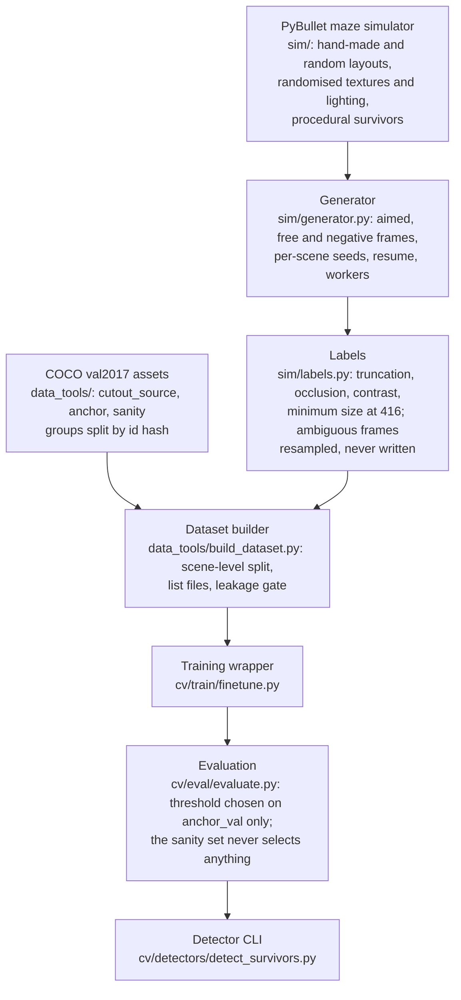

# NIDAR — Human (Survivor) Detection

Software for the **human (survivor) detection** subsystem of the NIDAR team's drone for **AirMouse 2026–27**, a fully autonomous drone challenge in a GPS-denied indoor maze.
It finds people in the drone's colour camera frames with a YOLO11n detector trained on simulated survivors and real COCO photos.
This repository covers **detection only**. Navigation, mapping, survivor tagging, obstacle avoidance, flight control and the ground station belong to other team members.

> **How to read this README.**
> - **[DONE]**: exists on `main` and has been run.
> - **Branch `name`**: exists only on that unmerged branch.
> - **[PLANNED]**: not built or not measured yet.
> - **ASSUMPTION**: a value we chose without a measured basis. **TBD**: unknown.
>
> Every number has its source and date next to it. "CLAUDE.md §6" means the status section of [CLAUDE.md](CLAUDE.md). "Demo report" means the local, gitignored files `outputs/demo/HANDOFF_v0.md` and `outputs/demo/detect_sim/eval/report.md` from 2 Nov 2026. No number in this README was measured on the arena, on a Raspberry Pi or with the real camera.

---

## 1. Status at a glance

| Component | Status | Where |
|---|---|---|
| Repo structure, config loader, logger, environment checks, conventions | [DONE] | [cv/config.py](cv/config.py), [cv/logger.py](cv/logger.py), [scripts/](scripts/), [docs/conventions.md](docs/conventions.md) |
| Decision records 001–008, engineering diary (days 1–2) | [DONE] | [docs/decisions/](docs/decisions/), [docs/diary/](docs/diary/) |
| Detector CLI (image, folder, video, webcam; JSONL + CSV + annotated output) | [DONE] | [cv/detectors/detect_survivors.py](cv/detectors/detect_survivors.py) |
| PyBullet maze simulator (layouts, random mazes, camera, procedural survivors, randomisation) | [DONE], with known defects (Section 10) | [sim/](sim/) |
| Labels with measured truncation, occlusion and contrast | [DONE] | [sim/labels.py](sim/labels.py) |
| Dataset generator (aimed / free / negative frames, seeds, resume, workers, replay) | [DONE] | [sim/generator.py](sim/generator.py) |
| Generated-run validation and contact sheets | [DONE] | [data_tools/check_generated.py](data_tools/check_generated.py), [data_tools/draw_boxes.py](data_tools/draw_boxes.py) |
| COCO val2017 assets: split, anchor and sanity sets, person cutouts | [DONE] | [data_tools/](data_tools/), [ADR 007](docs/decisions/007_real_data_sources.md) |
| Leakage check (training vs protected sets) | [DONE] | [data_tools/leakage.py](data_tools/leakage.py) |
| Dataset builder (E1 / E2 list files, scene-level split, leakage gate) | [DONE] | [data_tools/build_dataset.py](data_tools/build_dataset.py) |
| Training wrapper (Ultralytics, run records, batch probe) | [DONE] | [cv/train/finetune.py](cv/train/finetune.py) |
| Evaluation (own matching, AP50, threshold sweep, height bins, laptop speed) | [DONE] | [cv/eval/](cv/eval/) |
| v0 demo model, YOLO11n, 12 epochs (weights shared separately, not in git) | [DONE] as a demo run, not the final model | Sections 6 and 7 |
| ADR 009 forgetting protocol (paired bootstrap, scene-level sim_val) | Branch `feat/run-experiments` | not on `main` |
| Fixed run names and resume with a dataset hash check in the training wrapper | Branch `feat/run-experiments` | not on `main` |
| Training queue (several runs in sequence) | Work in progress on `feat/run-experiments`, not committed | not on `main` |
| Full E1 / E2 training of YOLO11n and YOLOv8n (ADR 008) | [PLANNED] | |
| Compositor (COCO cutouts on empty sim frames), clutter in the simulator | [PLANNED] | |
| Real test set `data/test_real/` | [PLANNED] | |
| Tracking and N-of-M confirmation | [PLANNED] | `cv/tracking/` |
| Depth module (distance, 3D point, size plausibility) | [PLANNED] | |
| Detection API `SurvivorDetector` and JSON schema | [PLANNED] | `interfaces/schemas/` holds only `.gitkeep` |
| NCNN export, Raspberry Pi inference script, Pi benchmark | [PLANNED] | `deploy/pi/` |

---

## 2. Target hardware

From [ADR 006](docs/decisions/006_pi_rgbd_hardware.md) (30 Oct 2026). None of the onboard specifications are confirmed.

| Item | Value | Status |
|---|---|---|
| Onboard computer | Raspberry Pi, CPU only, inference with an Ultralytics **NCNN** export | Decided |
| Pi model and memory | Pi 5, 8 GB, active cooling | ASSUMPTION |
| Pi OS, Python version | TBD | TBD |
| Inference speed on the Pi | not measured | TBD |
| Camera | RGB-D (colour + depth), aligned, shared capture timestamp | Decided |
| Camera model | TBD | TBD |
| Colour resolution, frame rate | 1280×720 at 30 FPS in `configs/arena.yaml` | ASSUMPTION |
| Field of view | 85° × 54° in `configs/arena.yaml` | ASSUMPTION |
| Mounting height and tilt | 0.8 m, 30° down in `configs/arena.yaml` | ASSUMPTION |
| Depth resolution, range, intrinsics | TBD | TBD |
| Required detection frame rate | to be set with the controls team | TBD |

- The **Jetson Nano is dropped**: no TensorRT, ONNX-to-TensorRT or Python 3.6 path.
- **No internet during a mission.** No cloud APIs. Weights and dependencies are local files.
- Detection shares the Pi with mapping, planning and obstacle avoidance, and is **never inside the flight-control loop**.
- **Development laptop:** Windows, Python 3.12, PyTorch 2.6 with CUDA 12.4, Ultralytics 8.4, RTX 3050 6 GB.

---

## 3. The model

From [ADR 004](docs/decisions/004_model_choice.md) (22 Oct 2026), kept by [ADR 006](docs/decisions/006_pi_rgbd_hardware.md) and [ADR 008](docs/decisions/008_training_protocol.md).

- **Primary: YOLO11n** (Ultralytics), single class `person` (class 0), input size **416** (drop to 320 if the Pi is too slow). It is a nano model small enough for CPU inference while the Pi runs other subsystems. The model summary in the demo eval log reads 2,582,347 parameters, 6.4 GFLOPs (2 Nov 2026).
- **Fallback and baseline: YOLOv8n**, trained on identical data with identical settings. It is used if YOLO11n's export or speed fails on the Pi.
- **Dropped:**
  - **RT-DETR:** the transformer encoder and decoder are too heavy for a CPU-only Pi at the frame rates needed.
  - **Larger YOLO sizes (s, m):** over the compute budget of a board shared with mapping, planning and obstacle avoidance.
  - **A custom YOLO + ViT hybrid:** complexity without a measured reason.
- **YOLO11's C2PSA block** is a lightweight partial spatial-attention block in the deepest backbone stage. **It is not a Vision Transformer.** Differences between YOLO11n and YOLOv8n come from several architecture changes and cannot be credited to attention alone.
- **The detector uses only the colour image.** Depth is used after detection: distance from the aligned depth inside the box, a 3D point in the camera frame from the intrinsics, and rejection of boxes with an implausible real-world size ([PLANNED], ADR 006).

---

## 4. The pipeline



1. **Simulator ([sim/](sim/)).** Mazes are built from ASCII grids ([sim/maze.py](sim/maze.py)): 6 hand-made layouts in [sim/layouts/](sim/layouts/) and seeded random mazes ([sim/layout_gen.py](sim/layout_gen.py)). Textures, lighting and frame augmentation are randomised ([sim/randomize.py](sim/randomize.py), [configs/randomization.yaml](configs/randomization.yaml)). Survivors are procedural bodies in 6 postures ([sim/survivor.py](sim/survivor.py)). A pinhole camera returns colour, a depth buffer and a segmentation mask ([sim/camera.py](sim/camera.py)).
2. **Generator ([sim/generator.py](sim/generator.py), [configs/generator.yaml](configs/generator.yaml)).** Each scene gets a new PyBullet client, its own layout and survivors (0/1/2/3 with weights 0.10/0.30/0.30/0.30, ASSUMPTION). Each frame slot draws a mode: **aimed** (camera pointed at a survivor), **free** (a random corridor pose) or **negative** (no survivor in view; survivors behind walls give hard negatives), with weights 0.55/0.20/0.25 (ASSUMPTION). Every seed is derived from (master seed, scene, stream, frame, attempt) with sha256, so a scene depends only on the master seed, its index and the config. Runs resume from per-scene `done.json` files. One, two or four workers give byte-identical output (CLAUDE.md §6, 2 Nov 2026). `replay_frame` re-renders any frame from its meta line.
3. **Labels ([sim/labels.py](sim/labels.py)).** Labels come from the segmentation mask. Each survivor is also rendered alone, which gives measured truncation and occlusion (Section 5.2). A survivor is dropped if its box is too small at 416, too truncated, too occluded or too faint. A frame with any dropped survivor is **ambiguous**. It is retried up to 5 times with a new pose and is never written, so an ambiguous frame never becomes a negative. Survivors below a minimum visible area count as absent, not dropped.
4. **COCO val2017 assets ([ADR 007](docs/decisions/007_real_data_sources.md)).** Every val2017 image id goes to `cutout_source`, `anchor` or `sanity` (0.40/0.40/0.20, ASSUMPTION) by a seeded hash of the id. The anchor set is mixed into training. The sanity set is held out and never trained on. Cutouts are RGBA person crops for the planned compositor.
5. **Dataset builder ([data_tools/build_dataset.py](data_tools/build_dataset.py), [configs/dataset.yaml](configs/dataset.yaml)).** It writes Ultralytics list files, no image copies. **E1** = sim_train only; **E2** = sim_train + every anchor_train image once ([ADR 008](docs/decisions/008_training_protocol.md)). Sim train and val share no scene group, master seed, maze seed or hand-made layout. The builder refuses to write if [data_tools/leakage.py](data_tools/leakage.py) finds any overlap with the protected sets (COCO sanity, and `data/test_proxy`, `data/test_real` when they exist).
6. **Training wrapper ([cv/train/finetune.py](cv/train/finetune.py), [configs/train.yaml](configs/train.yaml)).** It runs Ultralytics with imgsz 416, single class, seed 0, batch 64, workers 0, and writes a `run_record.json` (arguments, augmentation in effect, library versions, git commit, dataset hashes, per-epoch times, peak GPU memory). Ultralytics runs offline with its usage events off ([cv/utils/offline.py](cv/utils/offline.py)).
7. **Evaluation ([cv/eval/evaluate.py](cv/eval/evaluate.py), [cv/eval/metrics.py](cv/eval/metrics.py)).** Our own matching and AP50 (Section 5.5), cross-checked against Ultralytics `val`. The confidence threshold is chosen on **anchor_val only** and applied unchanged to every set. The COCO sanity set never chooses a threshold, an epoch or an early stop.
8. **Detector CLI ([cv/detectors/detect_survivors.py](cv/detectors/detect_survivors.py)).** Per-frame detection on images, folders, videos or a webcam (Section 7).

---

## 5. Mathematical specification

Notation: an image has width W and height H in pixels. A box is b = (x1, y1, x2, y2) in float pixels, origin top-left, x right, y down ([docs/conventions.md](docs/conventions.md)). Everything here is taken from the code on `main` and the ADRs.

### 5.1 Letterbox scale and minimum box size

The training size is S = 416. A W × H frame is letterboxed to S with the scale

  s = S / max(W, H)

([sim/labels.py](sim/labels.py) `LabelConfig.scale`). Label thresholds are set at training resolution in `configs/arena.yaml labels` (all ASSUMPTION): minimum box height h_min = 10 px, minimum box width w_min = 6 px, presence area a_min = 1.6 px². They are converted to the render size as

  h_render = h_min / s,  w_render = w_min / s,  a_render = a_min / s²,  ring_render = max(1, round(r / s)),

where r = 3 px is the contrast ring width. For example s = 0.65 at 640×360 and s = 0.325 at 1280×720 (`configs/arena.yaml` comment), so the 10 px minimum height becomes 15.4 px and 30.8 px (CLAUDE.md §6). The same 10 px / 6 px rule at 416 decides which COCO images enter the anchor and sanity sets ([ADR 007](docs/decisions/007_real_data_sources.md)).

### 5.2 Truncation and occlusion

Each survivor is rendered **alone**, with the same camera, on a canvas extended past the frame where the survivor overhangs it (area capped at 4.0 × the frame, ASSUMPTION). Let A_in and A_out be the survivor-alone pixels inside and outside the frame, and V the survivor's visible pixels in the real render. Then

  truncation T = |A_out| / (|A_in| + |A_out|)

  occlusion O = 1 − |V ∩ A_in| / |A_in|  (O = 0 if A_in is empty)

([sim/labels.py](sim/labels.py) `Silhouette`). A label is dropped when T > 0.85 (`truncated`) or O > 0.90 (`occluded`), both ASSUMPTION. When the canvas cap is reached or the survivor is behind the near plane, T is only a lower bound, and the label is dropped as `truncation_unbounded`.

### 5.3 Contrast

How much a visible survivor stands out, in grey levels 0–255 ([sim/labels.py](sim/labels.py) `survivor_contrast`), measured on the frame after augmentation:

  C = max over channels c of | mean_{p ∈ V} I_c(p) − mean_{p ∈ R} I_c(p) |

where R is V dilated by the ring width (square structuring element) minus every survivor pixel. Taking the per-channel maximum keeps colour-only contrast. A label with C < 3.0 is dropped (`low_contrast`, essentially invisible). A kept label with C < 8.0 is tagged `hard`. Both thresholds are ASSUMPTION, chosen by eye from crops sorted by contrast (CLAUDE.md §6, 1 Nov 2026).

**Frame outcome.** A survivor with visible area under a_render is absent. A present survivor is dropped for any of `box_too_short`, `box_too_narrow`, `truncated`, `truncation_unbounded`, `occluded`, `low_contrast`. A frame is **ambiguous** if any present survivor is dropped, **positive** if it has kept labels and none dropped, and **negative** if no survivor is present.

### 5.4 Aimed-pose sampling

For an aimed frame the generator picks a survivor and takes the centre (c_x, c_y) of its 3D box ([sim/generator.py](sim/generator.py) `aimed_candidate`). It draws a horizontal distance d in [d_min, d_max], either

  uniform: d ~ U(d_min, d_max), or  log-uniform: d = exp(U(ln d_min, ln d_max)),

and an azimuth α ~ U(0, 2π), and puts the camera at (c_x + d cos α, c_y + d sin α). The yaw is the bearing to the survivor plus an offset drawn from U(−k·φ, k·φ), where φ = atan((W/2) / f) is half the horizontal field of view, f is the focal length in pixels, and k = 0.6 (ASSUMPTION). Height, pitch and roll are drawn from the config ranges. A candidate is rejected if it fails the trajectory sampler's clearance checks, if the survivor's centre projects outside the frame, or if a ray from the camera to the survivor is blocked.

| Config | d range | Sampling |
|---|---|---|
| [configs/generator.yaml](configs/generator.yaml) | 0.6–3.5 m | uniform |
| [configs/generator_train.yaml](configs/generator_train.yaml), [configs/generator_val.yaml](configs/generator_val.yaml) | 0.6–6.0 m | log-uniform |

All distances are ASSUMPTION. The log-uniform median over 0.6–6.0 m is sqrt(0.6 · 6.0) = 1.90 m (CLAUDE.md §6).

### 5.5 Matching and metrics

As computed in [cv/eval/metrics.py](cv/eval/metrics.py):

- **IoU:** IoU(A, B) = |A ∩ B| / |A ∪ B| (0 when the union is empty).
- **Matching:** predictions are taken in order of decreasing score. Each takes the unmatched ground-truth box with the highest IoU, and is a true positive (TP) if that IoU is ≥ 0.5. Unmatched predictions are false positives (FP), unmatched ground-truth boxes false negatives (FN). Because matching is greedy in score order, raising the threshold never changes the matches of the predictions above it.
- **Precision** P = TP / (TP + FP), **recall** R = TP / (TP + FN), **F1** = 2PR / (P + R).
- **AP50:** sort all predictions by score and compute cumulative precision and recall. Append (last recall, 0) and (1, 0), take the precision envelope (running maximum from the right), and integrate it with the trapezoid rule at 101 evenly spaced recall points. This is the same integration as Ultralytics 8.4 `compute_ap` (tested against the installed function). Ultralytics' own matching differs, so its mAP50 is reported next to ours as a cross-check.
- **Operating threshold:** the lowest confidence with at most 0.2 FP per image on anchor_val (ASSUMPTION; recall is the priority). The candidates are the prediction scores themselves, not a grid.
- **Recall by box height** at 416, bins [0, 20), [20, 40), [40, 80), [80, ∞) px.

### 5.6 N-of-M confirmation [PLANNED]

Not built yet. A track is confirmed at frame t when it was matched in at least N of the last M frames:

  Σ_{k=t−M+1}^{t} d_k ≥ N,  d_k = 1 if the track was matched in frame k.

If a false alarm appears independently in each frame with probability q, and a real survivor is detected independently with probability r, then

  P(false track confirmed) = Σ_{j=N}^{M} C(M, j) q^j (1 − q)^{M−j}

  P(real survivor confirmed) = Σ_{j=N}^{M} C(M, j) r^j (1 − r)^{M−j}.

Video frames are not independent, so these are optimistic. N and M will be chosen from measured per-frame rates, not guesses. No values are chosen yet.

---

## 6. Results so far

**Demo run, not the ADR 009 experiment.** One YOLO11n model, fine-tuned for 12 epochs, 2 Nov 2026 at commit `f20e766` (demo report). It is a quick demo, not the final model, and nothing here was measured on the arena.

**What the demo model was trained on** (`outputs/demo/train_summary.json` and generator `run.json` files, local, 2 Nov 2026):
- Variant E2 from COCO-pretrained `yolo11n.pt`, imgsz 416, 12 epochs, patience 5, batch 64.
- 3550 training images, 56 iterations per epoch:
  - 2558 sim frames from 80 scenes, made with [configs/generator_train.yaml](configs/generator_train.yaml) and seed 1000. Hand-made layouts `dead_end`, `l_turn`, `straight_corridor`, `two_rooms`, plus seeded random mazes.
  - 992 COCO anchor_train images.
- Wall time 1393 s on the development laptop.
- sim_val: 639 frames from 20 scenes, [configs/generator_val.yaml](configs/generator_val.yaml), seed 2000. Hand-made layouts `loop` and `t_junction`, which training never saw, plus random mazes.

**Accuracy** (demo report, 2 Nov 2026): IoU 0.5, our matching. Each model's threshold was chosen on anchor_val and applied unchanged to every set: demo 0.403, pretrained yolo11n 0.314.

| Set | Label | Model | Images | GT boxes | P | R | F1 | AP50 |
|---|---|---|---|---|---|---|---|---|
| sim_val | simulation validation, not arena | demo | 639 | 378 | 0.975 | 0.841 | 0.903 | 0.910 |
| sim_val | simulation validation, not arena | pretrained yolo11n | 639 | 378 | 0.714 | 0.013 | 0.026 | 0.055 |
| anchor_val | COCO sanity set, not arena | demo | 166 | 304 | 0.780 | 0.385 | 0.515 | 0.511 |
| anchor_val | COCO sanity set, not arena | pretrained yolo11n | 166 | 304 | 0.859 | 0.661 | 0.747 | 0.782 |
| COCO sanity | COCO sanity set, not arena | demo | 560 | 1282 | 0.796 | 0.363 | 0.498 | 0.533 |
| COCO sanity | COCO sanity set, not arena | pretrained yolo11n | 560 | 1282 | 0.881 | 0.687 | 0.772 | 0.807 |

Recall by ground-truth box height at 416, COCO sanity set, not arena (demo report, 2 Nov 2026):

| Model | < 20 px | 20–40 px | 40–80 px | > 80 px |
|---|---|---|---|---|
| demo | 0.000 (0/77) | 0.061 (11/181) | 0.234 (62/265) | 0.516 (392/759) |
| pretrained yolo11n | 0.091 (7/77) | 0.293 (53/181) | 0.540 (143/265) | 0.893 (678/759) |

**What this shows.** The fine-tuned model is much better than the pretrained one on simulated survivors (recall 0.841 vs 0.013). It is much worse on real people (recall 0.363 vs 0.687 on the COCO sanity set), worst on small people. **It has forgotten real people.** That happened even with the COCO anchor photos in its training data (variant E2). Fixing this forgetting is the next step: the full E1 / E2 runs ([ADR 008](docs/decisions/008_training_protocol.md)), judged by the rules in ADR 009 (branch `feat/run-experiments`).

**Speed** (demo report, 2 Nov 2026). Development laptop, **not a Raspberry Pi**. Detector only (pre-processing, inference, post-processing), imgsz 416, batch 1, 100 sim_val frames, torch 8 threads, power plan Balanced, plugged in:

| Model | Device | ms median | ms p90 |
|---|---|---|---|
| demo | CPU | 37.9 | 46.6 |
| demo | GPU (RTX 3050) | 7.2 | 8.4 |
| pretrained yolo11n | CPU | 21.0 | 23.1 |
| pretrained yolo11n | GPU (RTX 3050) | 7.8 | 12.6 |

The two models have the same architecture. Earlier runs of the pretrained model measured 35.3–38.9 ms median on CPU (CLAUDE.md §6, 2 Nov 2026), so the CPU gap here is probably run-to-run spread on the laptop. **No speed has been measured on the Raspberry Pi.**

Pretrained baselines on the earlier dry lists (YOLOv8n and YOLO11n, 2 Nov 2026) are in CLAUDE.md §6.

---

## 7. Using the detector today (v0)

**Per-frame detection only.** No tracking, no multi-frame confirmation, no depth, distance or 3D position yet. Not tested on the arena, on dummies or on another team's simulator.

**Pick the model by what your survivors look like:**

| Your survivors look like | Use | Threshold | Why (demo report, 2 Nov 2026) |
|---|---|---|---|
| Simple 3D body shapes, like our simulator | `survivor_yolo11n_demo.pt` (fine-tuned) | conf 0.403 | sim_val recall 0.841, precision 0.975 (simulation validation, not arena) |
| Real people | `yolo11n.pt` (COCO-pretrained, unchanged), person class only | conf 0.314 | COCO sanity recall 0.687, precision 0.881 (COCO sanity set, not arena) |

**Weights are not in this repository.**
- The demo weights are shared separately with the owner's handoff note. Their sha256 is `48ec15d7ad1c2b90130ae96dce98e30815d049b6c731360ae1418779d581063f`; check it before use.
- The pretrained weights come from `python scripts/download_weights.py`, at setup time only. It prints sha256 but does not verify it.
- Put weight files in `models/`, which is gitignored.

**Command line** ([cv/detectors/detect_survivors.py](cv/detectors/detect_survivors.py)). Always pass `--imgsz 416`: the default from [configs/default.yaml](configs/default.yaml) is 640, the baseline setting.

```powershell
python -m cv.detectors.detect_survivors --source <image | folder | video.mp4 | camera index> --model models/survivor_yolo11n_demo.pt --conf 0.403 --imgsz 416 --device cuda:0 --out outputs/run_demo
python -m cv.detectors.detect_survivors --source <...> --model models/yolo11n.pt --conf 0.314 --imgsz 416 --device cpu --out outputs/run_pretrained
```

The script keeps only class 0 (person). It writes `<out>/detections.jsonl`, `<out>/detections.csv` and annotated images or an annotated video. `--show` opens a preview window.

**Python:**

```python
import os

os.environ["YOLO_OFFLINE"] = "1"  # before importing Ultralytics: no network calls or usage events

import cv2
from ultralytics import YOLO

model = YOLO("models/survivor_yolo11n_demo.pt")  # shared separately, not in git
frame = cv2.imread("frame.jpg")  # BGR numpy array
r = model.predict(frame, conf=0.403, classes=[0], imgsz=416, verbose=False)[0]
dets = [(*b.xyxy[0].tolist(), float(b.conf)) for b in r.boxes]  # x1, y1, x2, y2, confidence
```

**Output format.** One JSON line per frame, following [docs/conventions.md](docs/conventions.md). This line is real output of the demo model on a sim_val frame, taken from the demo detection run (2 Nov 2026, GPU, conf 0.5), indented here for reading:

```json
{
  "frame_id": 2,
  "source": "s00000_f025.jpg",
  "video_time_s": null,
  "timestamp_utc": "2026-11-02T15:12:12.594Z",
  "frame_width": 640,
  "frame_height": 360,
  "inference_ms": 8.0,
  "detections": [
    {
      "det_id": 0,
      "class_id": 0,
      "class_name": "person",
      "confidence": 0.9033,
      "bbox_xyxy": [307.5, 77.9, 532.0, 147.8],
      "bbox_center": [419.7, 112.8]
    }
  ]
}
```

- `bbox_xyxy`: float pixels, origin top-left, x right, y down. `confidence`: 0–1. `class_name`: always `"person"`.
- `timestamp_utc`: UTC ISO 8601 with milliseconds and `Z`. **Today it is the time the frame was processed, not the camera capture time.** How the capture timestamp is passed in is TBD with the controls team.
- `video_time_s`: null for images.

**Planned handoff interface [PLANNED]** (CLAUDE.md §8, ADR 006):
- The call: `SurvivorDetector(backend="pytorch" | "ncnn", weights=..., imgsz=416, conf=...).detect(frame_bgr, depth=None)`.
- It returns a list of detections with `x1, y1, x2, y2`, `confidence`, `class_name`, `distance_m`, `point_cam_xyz_m` (ASSUMPTION: OpenCV camera axes) and `depth_valid`, plus the capture timestamp.

---

## 8. Quick start (development laptop)

Prerequisites: Python 3.12, Git, and optionally an NVIDIA GPU with a CUDA 12.4 driver.

```powershell
git clone https://github.com/AryanGoyal17/NIDAR-Automation.git
cd NIDAR-Automation
python -m venv .venv
.\.venv\Scripts\Activate.ps1
pip install --upgrade pip
pip install torch torchvision --index-url https://download.pytorch.org/whl/cu124   # CPU only: pip install torch torchvision
pip install -r requirements/requirements-dev.txt     # base + CV + PyBullet + ruff, pytest, pre-commit
pre-commit install                                   # once per clone: ruff on every commit
python scripts/check_env.py                          # environment health
python scripts/download_weights.py                   # setup only: yolov8n.pt and yolo11n.pt into models/
```

- On Linux or macOS, activate with `source .venv/bin/activate`.
- PyBullet has no prebuilt wheel for Python 3.12 on some systems and may build from source. If the build fails, use a separate Python 3.10 or 3.11 environment for the simulator only.
- Requirements: [requirements/requirements-dev.txt](requirements/requirements-dev.txt). The Pi file [requirements/requirements-pi.txt](requirements/requirements-pi.txt) is ASSUMPTION and untested.

**Checks:**

```powershell
.\scripts\check.ps1          # ruff check + ruff format --check + pytest; heavy scene checks skipped (before every commit)
.\scripts\check.ps1 -Full    # adds the scene checks (NIDAR_SCENE_TESTS=1); fails on any skip not allowlisted (before a merge)
```

**Data, training and evaluation** (commands that exist on `main`, from CLAUDE.md §7). Datasets and weights are **produced locally and never committed**. Everything lands in the gitignored `data/`, `models/` and `outputs/`.

```powershell
# Synthetic frames (re-running resumes; another seed, scene count or config is refused)
python -m sim.generator --out data/sim_raw/run1 --scenes 40 --frames-per-scene 12 --seed 2026 --workers 4
python -m data_tools.check_generated --run data/sim_raw/run1 --stats         # validate a run (exit 1 if invalid)
python -m data_tools.draw_boxes --run data/sim_raw/run1 --out sheet.png --tiles 24

# COCO val2017 (the only download, setup time only)
python -m data_tools.get_coco
python -m data_tools.coco_split                               # cutout_source / anchor / sanity
python -m data_tools.coco_person_sets                         # anchor and sanity YOLO sets (--plan: estimate only)
python -m data_tools.make_person_cutouts                      # RGBA cutouts
python -m data_tools.leakage --train data/coco_person/anchor/images --cutouts data/coco_cutouts

# Dataset lists, training, evaluation
python -m data_tools.build_dataset --plan                     # counts only; without --plan writes data/yolo_ds/
python -m cv.train.finetune --subset 300 --epochs 1 --tag dry  # dry run; without --subset/--epochs: full runs from configs/train.yaml
python -m cv.train.finetune --probe-batch --variant e2 --workers 0
python -m cv.eval.evaluate --model yolo11n.pt --data sim_val=data/yolo_ds/eval/sim_val.txt --data anchor_val=data/yolo_ds/eval/anchor_val.txt --data sanity=data/yolo_ds/eval/sanity.txt --out outputs/eval/baseline --speed
```

- The training and validation generator configs are [configs/generator_train.yaml](configs/generator_train.yaml) (seed 1000) and [configs/generator_val.yaml](configs/generator_val.yaml) (seed 2000). Pass one with `--config`.
- The full planned sizes are 160 × 32 and 30 × 32 frames. These full runs have not been generated (CLAUDE.md §6).
- `cv.eval.evaluate` chooses the threshold on `anchor_val` and refuses the sanity set as the operating set.

---

## 9. Repository layout

```
configs/        arena, randomization, generator (+ _train, _val), dataset, train, coco, default (baseline CLI)
cv/             config.py, logger.py
  detectors/    detect_survivors.py (detector CLI)
  eval/         metrics.py, evaluate.py
  train/        finetune.py
  utils/        offline.py, run_info.py
sim/            maze, layout_gen, camera, trajectory, survivor, randomize, labels, generator; layouts/ (6 hand-made)
data_tools/     build_dataset, check_generated, draw_boxes, get_coco, coco_common, coco_split,
                coco_person_sets, coco_sheets, make_person_cutouts, leakage
scripts/        check.ps1, check_env.py, verify_environment.py, download_weights.py, check_sim.py,
                sim_preview.py, setup_repo_structure.ps1 / .sh
docs/           conventions.md, arena_questions.md, decisions/ (ADR 001–008), diary/, setup/
requirements/   base, cv, sim, pi (ASSUMPTION), dev
tests/          test_cv/, test_sim/, test_data_tools/, test_interfaces/ (empty)
interfaces/     schemas/ (empty: the detection JSON schema is PLANNED)
notebooks/      empty
data/ models/ outputs/   gitignored; only data/README.md (licence terms) is committed
```

---

## 10. Known limitations and open questions

From CLAUDE.md §5 and §6.

- **No arena data.** There is no real test set, no arena footage and no dummy footage. Every score is either simulation validation or COCO sanity, and neither predicts performance in the maze.
- **Survivor type unknown:** real people or dummies. A COCO "person" model may miss dummies.
- **Forgetting:** the demo model lost about half of the pretrained model's recall on real people (Section 6).
- **Synthetic survivors are easier than real ones.** Normal-light contrast median 59.3 grey levels at 1280×720, and only 3.4–5.2 % of kept labels are `hard` depending on the sample (CLAUDE.md §6, 1 Nov 2026).
- **Simulator defects** (CLAUDE.md §6):
  - Sitting, supine and prone postures have misaligned or detached parts, and the config posture list is ignored.
  - Lying survivors' parts overlap walls (30 of 48 survivors in one check, an upper bound), which inflates occlusion.
  - Floor colours can be strongly tinted, and walls are darker than floors under the overhead light.
  - About 33–47 % of low-light survivors fall under contrast 3.0 and are dropped as `low_contrast`, depending on the sample (CLAUDE.md §6, 1 Nov 2026).
  - `sim/camera.py` returns the raw, non-metric depth buffer.
- **Camera and Pi untested:** model, resolution, field of view, depth range and Pi speed are all TBD or ASSUMPTION.
- **The detector CLI does not run Ultralytics offline yet.** Unlike training and evaluation, `detect_survivors.py` does not call [cv/utils/offline.py](cv/utils/offline.py). On a networked laptop with Ultralytics `sync` enabled it may send Ultralytics' anonymous usage events. Set `YOLO_OFFLINE=1` before running it.
- **Capture timestamp:** the output carries the processing time, not the capture time (Section 7).
- **Fresh clone:** `check.ps1 -Full` fails until the detector CLI has written a `detections.jsonl` under `outputs/`, because 4 live-output tests skip without one.
- **Other open questions:** required detection frame rate, arena dimensions and lighting, the **new deadline (TBD)**, and the repository visibility and licence.

---

## 11. What has been done so far

Dates from `git log` on `main` and [docs/diary/](docs/diary/).

| Date | Work |
|---|---|
| 3–4 Oct 2026 | Repository, tooling and Git decisions ([ADR 001](docs/decisions/001_tooling.md)–[003](docs/decisions/003_large_files.md)), Python 3.12 + CUDA environment, config loader, logger, conventions, ruff and pytest, baseline YOLOv8n detector ([diary day 1](docs/diary/day1_foundation.md)). |
| 21–22 Oct 2026 | Weight downloader, PyBullet smoke test, detection output conventions, [ADR 004](docs/decisions/004_model_choice.md) model choice and [ADR 005](docs/decisions/005_data_strategy.md) data strategy, first simulator modules: arena config, maze builder, procedural survivors, labels ([diary day 2](docs/diary/day2_decisions_and_conventions.md)). |
| 30 Oct 2026 | Raspberry Pi + RGB-D decision ([ADR 006](docs/decisions/006_pi_rgbd_hardware.md)), Jetson dropped, lint clean-up, pre-commit and `check.ps1`, light direction fix. |
| 1 Nov 2026 | Simulator fixes: texture brightness, floor colours, start-cell placement, survivor 3D boxes, pose clearance, sequences. Portable render pin, `check.ps1 -Full`. Labels with measured truncation, occlusion and contrast. |
| 1 Nov 2026 | Dataset generator, run validation and contact sheets (measured 40-scene run on 2 Nov). |
| 2 Nov 2026 | COCO val2017 download, split, anchor and sanity sets, cutouts and leakage check ([ADR 007](docs/decisions/007_real_data_sources.md)). Generator train and val configs, dataset builder, evaluation, offline Ultralytics, training wrapper ([ADR 008](docs/decisions/008_training_protocol.md)). |
| 2 Nov 2026 | v0 demo run: YOLO11n E2, 12 epochs, evaluated against the pretrained model (Section 6). ADR 009 and training resume on branch `feat/run-experiments`. |

---

## 12. Documentation, rules and licences

**Decision records on `main`:**
- [001 Tooling](docs/decisions/001_tooling.md), [002 Git workflow](docs/decisions/002_git_workflow.md), [003 Large files](docs/decisions/003_large_files.md).
- [004 Model choice](docs/decisions/004_model_choice.md), [005 Data strategy](docs/decisions/005_data_strategy.md), [006 Raspberry Pi and RGB-D](docs/decisions/006_pi_rgbd_hardware.md).
- [007 Real data sources](docs/decisions/007_real_data_sources.md), [008 Training protocol](docs/decisions/008_training_protocol.md).
- ADR 009 (forgetting protocol) is only on branch `feat/run-experiments`.

**Other docs:** [CLAUDE.md](CLAUDE.md) (project context and full status), [docs/conventions.md](docs/conventions.md), [docs/arena_questions.md](docs/arena_questions.md), [docs/diary/](docs/diary/), [data/README.md](data/README.md).

**Development rules** (CLAUDE.md §9–10):
- One task = one branch from `main`, with conventional commits. The owner merges.
- `.\scripts\check.ps1` before every commit; `.\scripts\check.ps1 -Full` before asking for a merge.
- Never commit datasets, generated images, weights (`.pt`, NCNN exports), videos, secrets or personal information. Record sha256 checksums instead ([ADR 003](docs/decisions/003_large_files.md)).
- Never write a number that was not measured. Use TBD or ASSUMPTION.

**Licences:**
- **Ultralytics** (YOLO11, YOLOv8) is licensed **AGPL-3.0**. Check its terms before distributing this code or the weights.
- **COCO:** annotations CC BY 4.0, images from Flickr under their own licences. Internal research use only, never committed or redistributed ([data/README.md](data/README.md)).
- **Data and weights are not in this repository.** They are produced by the commands above or shared separately.
- **This repository's licence and visibility:** TBD.
